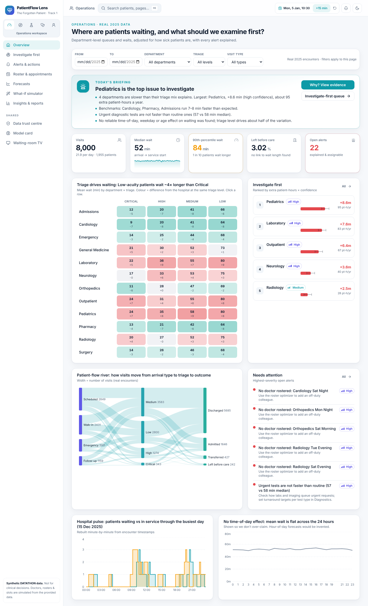
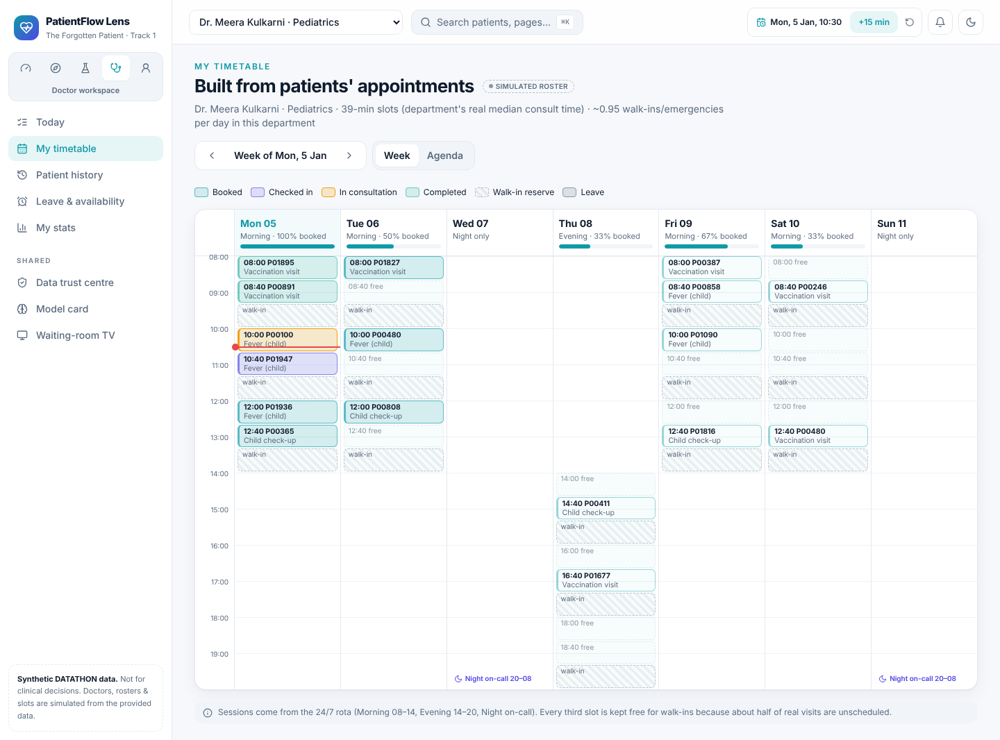
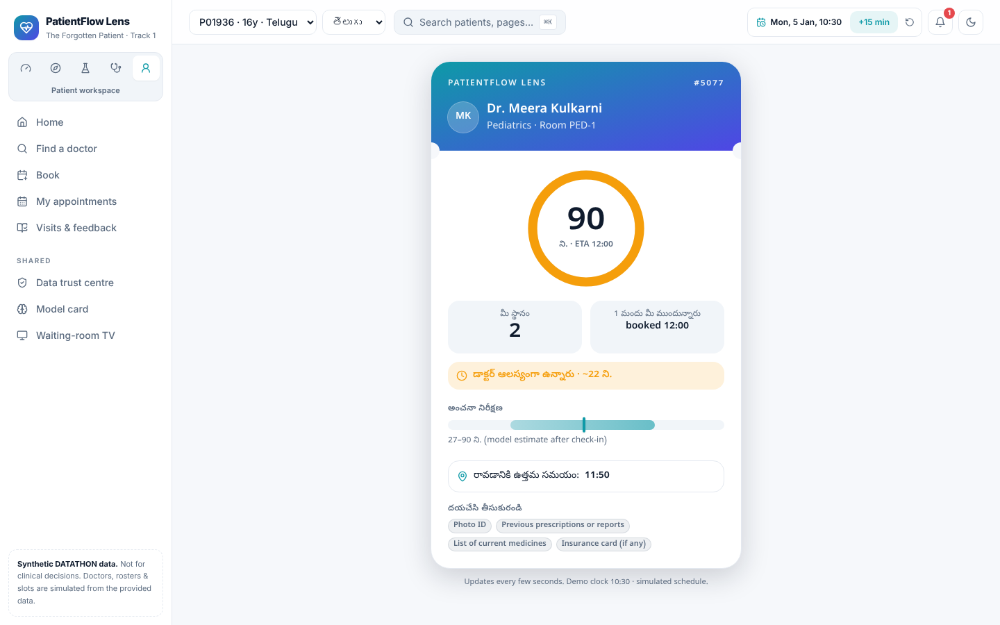
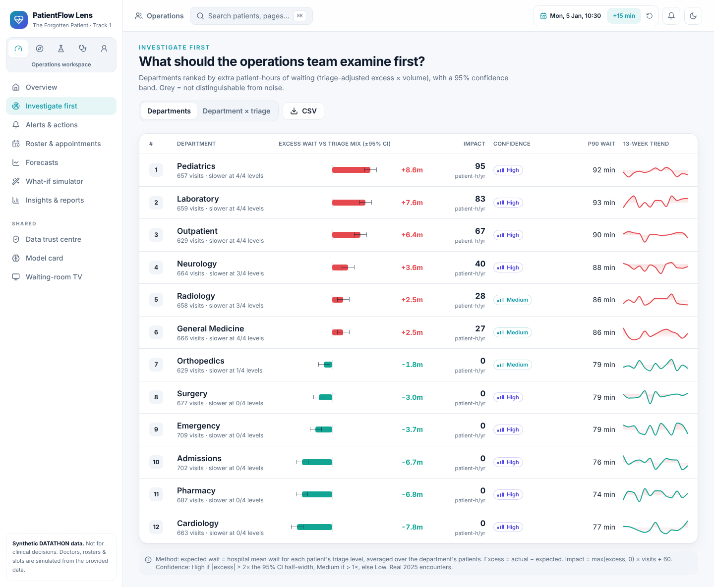
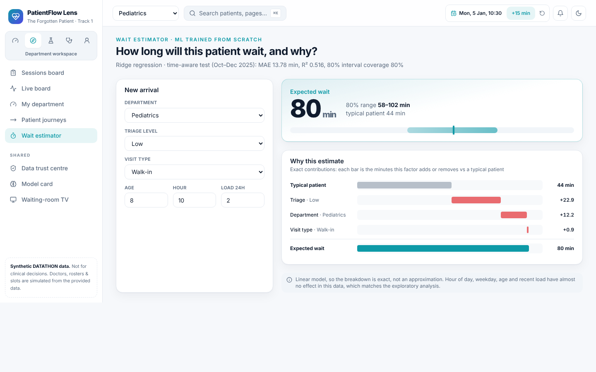
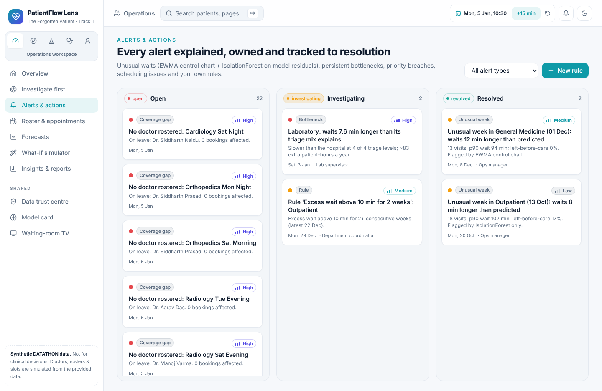
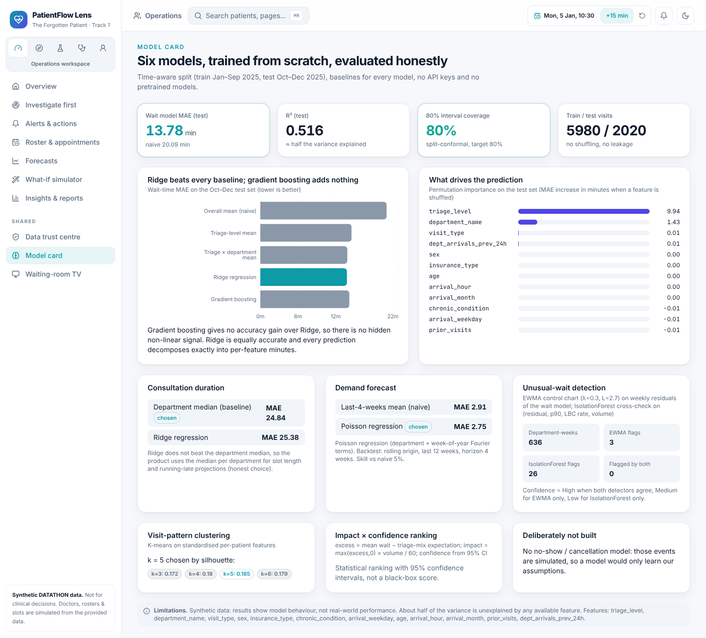

# PatientFlow Lens

**DATATHON 2026 · Track 1 · Health: "The Forgotten Patient"**

PatientFlow Lens helps a hospital see where patients are waiting, why they are waiting, and what to fix first. It is a full website with five views (hospital management, department coordinators, diagnostics staff, doctors and patients), powered by machine-learning models we trained ourselves on the provided data.

> ⚠️ Built on the synthetic DATATHON dataset. Not for real clinical decisions.



---

## The problem

A patient's visit moves through several stages: arrival, triage, waiting, consultation, tests and discharge. When each stage is managed separately, delays are easy to miss. Hospital teams need to know:

**"What is likely to get delayed next, why, and what should we look at first?"**

## Target users

- **Hospital operations managers**: see the whole hospital and decide what to fix first
- **Department coordinators**: manage their department's queues and patients
- **Service administrators**: keep diagnostic tests (lab, imaging) on time
- **Doctors**: see their schedule and patient history
- **Patients**: book appointments and see honest wait times

## What we built

| Workspace | Who it's for | What it does |
|---|---|---|
| 🏥 **Operations** | Hospital managers | Daily summary, the departments that need attention first (with the reasons), alerts that can be assigned and tracked, staff rota planning, forecasts, a what-if simulator, and a weekly PDF report |
| 🧭 **Department** | Department coordinators | Today's doctors and queues, a live replay of a real day minute by minute, patient journeys, and a wait-time estimator |
| 🧪 **Diagnostics** | Lab / imaging staff | Test turnaround times, an alert when urgent tests aren't being prioritised, and target tracking |
| 🩺 **Doctor** | Doctors | A weekly timetable built from patient bookings, today's queue with one-tap actions, patient history, and leave requests |
| 🙂 **Patient** | Patients | Find a doctor, book an appointment, join a waitlist, check in, and follow a live wait ticket, in **English, Hindi or Telugu** |

Plus a **Data Trust Centre** (every data-quality issue we found and how we handled it), a **Model Card** (how every model was tested) and a **waiting-room TV screen**.

## Our ML model (trained from scratch)

Our main model is a **supervised regression model (Ridge regression)** that predicts **how long a patient will wait** before being seen.

**Sample output** for a low-urgency walk-in patient in Pediatrics:

```
Expected wait: 80 minutes
Likely range:  58–102 minutes
Why:           typical patient 44 min
               + 23 min because of low urgency (triage)
               + 12 min because of the department (Pediatrics)
               + 1 min  because it is a walk-in
```

**How well it works:** we trained on January–September 2025 and tested on October–December, data the model had never seen.

| | Average error |
|---|---|
| Just guessing the average | 20.1 min |
| **Our model** | **13.8 min** |

Its predicted range contained the real wait **80% of the time**, exactly as intended. We also tried a more complex model (gradient boosting); it was not more accurate, so we kept the simpler one because it can explain every prediction.

**Supporting models:** unusual-delay detection (control chart + Isolation Forest), weekly demand forecasting (Poisson regression) and patient visit-pattern grouping (K-means).

**Training code:** [`patientflow-lens/backend/app/ml/train.py`](patientflow-lens/backend/app/ml/train.py)

**Data loading and cleaning:** [`patientflow-lens/backend/app/etl/clean.py`](patientflow-lens/backend/app/etl/clean.py) reads the four dataset files from [`patientflow-lens/backend/data/raw/`](patientflow-lens/backend/data/raw)

## Key findings

- **Urgency level drives waiting time.** Low-urgency patients wait about 4× longer than critical ones.
- **Pediatrics, Laboratory and Outpatient are slower than they should be**, even after accounting for how urgent their patients are. Pediatrics is the top issue at +8.6 minutes per visit.
- **Urgent diagnostic tests are not faster than routine ones** (57 vs 58 minutes).
- Waiting time does **not** depend on time of day, weekday, age, sex or insurance, so we show that honestly instead of inventing patterns.

## Data we used

All four provided files: `patients.csv`, `encounters.csv`, `departments.csv`, `diagnostic_tests.csv`.

The dataset has no doctors, schedules or appointment slots, so we **generated them from the provided files** (staff counts, visit types and times). Everything generated is clearly marked **"Simulated"** in the app. All waiting times and outcomes are the real dataset values. No outside data was used.

## How to run it

You need **Python 3.11+** (tested on 3.13). The website is already built, so Node.js is not required.

```bash
cd patientflow-lens/backend
pip install -r requirements.txt
python -m scripts.bootstrap
python -m uvicorn app.main:app --port 8000
```

Then open **http://localhost:8000**.

- `bootstrap` cleans the data, trains all the models and prepares the demo data (about 10 seconds).
- Use the **5 icons at the top of the sidebar** to switch between workspaces.
- The demo clock is set to **Mon 5 Jan 2026, 10:30**; use **"+15 min"** in the top bar to move time forward.
- Run the tests with `python -m pytest -q tests` (37 tests).

## Built with

**Backend:** Python, FastAPI, scikit-learn, pandas, SQLite
**Frontend:** React, TypeScript, Tailwind CSS, Recharts

No external AI APIs, no API keys and no pretrained models are used. All models are trained from scratch on the provided data. We used Claude as a coding assistant while building the project; the app itself does not use any AI service.

## Screenshots

| | |
|---|---|
|  |  |
| Doctor timetable built from bookings | Patient live wait ticket (Telugu) |
|  |  |
| Which department to investigate first | Wait estimate with the reasons |
|  |  |
| Alerts with owners and evidence | Model results |

## More details

Full technical documentation and a demo script: [`patientflow-lens/README.md`](patientflow-lens/README.md)
